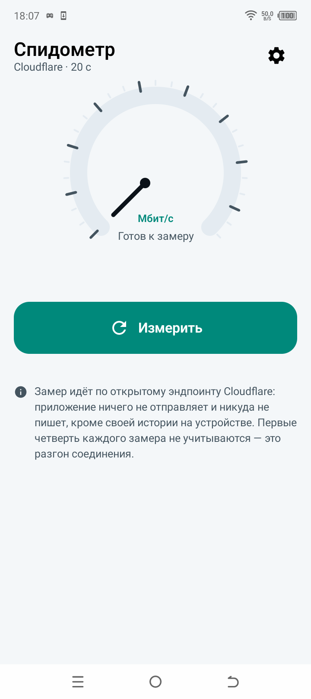
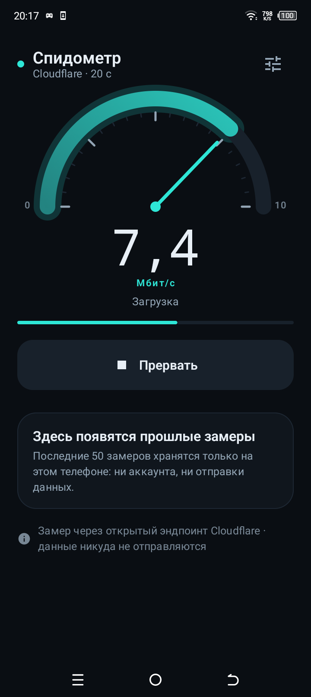
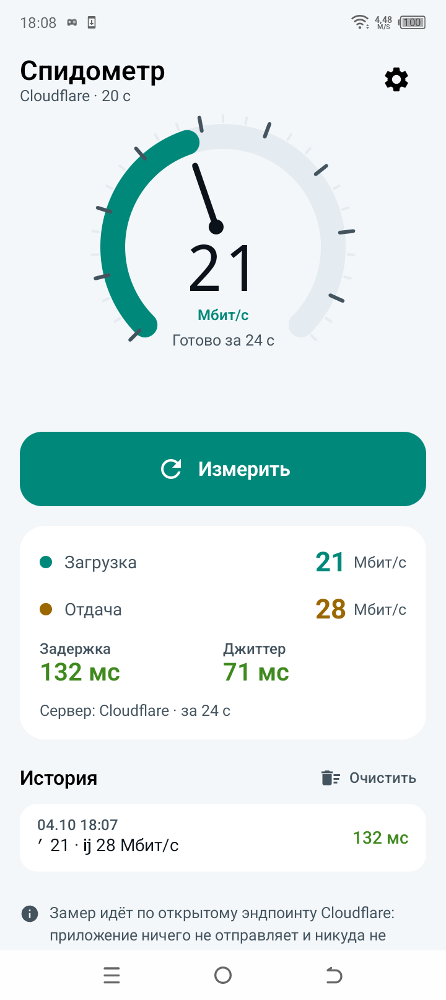
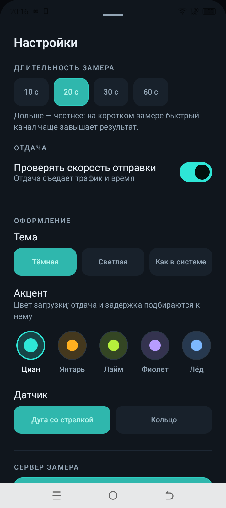
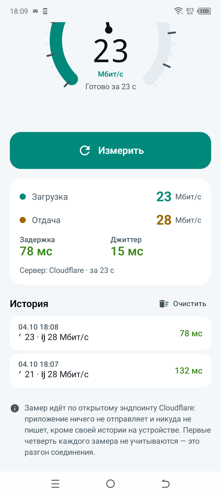

# Спидометр — измерение скорости интернета на телефоне

Приложение для Android: измеряет скорость загрузки и отдачи, задержку и
джиттер. Без аккаунтов, без рекламы, без отправки данных.

## Что измеряет

| Метрика | Как считается |
|---------|---------------|
| Загрузка | **4 параллельных соединения** с открытого эндпоинта Cloudflare. После прогрева каждые 500 мс снимается прирост байтов; результат — **медиана** окон |
| Отдача | Те же 4 потока в обратную сторону; замер заканчивается ответом сервера, а не опустошением буфера телефона |
| Задержка | Время до заголовков ответа (TTFB), 10 запросов, первый — прогрев. Тело читается до конца, поэтому соединение переиспользуется и не платит за TLS каждый раз |
| Джиттер | Медиана абсолютных разниц между соседними замерами задержки |

В результате показываются не только медианы, но и **коридор P10–P90** и число
окон: видно, насколько ровно канал держит скорость.

### Почему так, а не «как в других приложениях»

- **Несколько потоков.** Один TCP-поток на канале с большой задержкой не
  успевает заполнить трубу: на гигабитном канале он покажет половину.
  Четыре соединения дают цифру, которую можно сравнивать с тарифом.
- **Окно измерения, а не файл целиком.** Считается не «сколько весил файл», а
  сколько байт реально пришло за реальное время на каждом отрезке.
- **Медиана без выбрасывания.** Раньше из серии удалялся самый медленный
  замер — это систематически завышало результат. Теперь ничего не
  выбрасывается: медиана сама устойчива к единичному выбросу.
- **Прогрев не в счёт.** Первые 900 мс — разгон TCP и TLS; в результат они не
  попадают.
- **Скорость по фактическим байтам**, а не по заявленному `Content-Length`:
  обрыв на середине иначе показал бы фантастические мегабиты.
- **Сжатие запрещено** (`Accept-Encoding: identity`): иначе считался бы
  сжатый объём вместо реального трафика.
- **Смена сети обнуляет доверие.** Если во время замера Wi-Fi сменился на
  мобильную сеть, результат помечается как несравнимый: это смесь двух
  каналов.
- **Неудачный замер не пишется в историю.** Ноль в списке выглядел бы как
  реальная скорость 0 Мбит/с.

Трафик ограничен: не больше 60 МБ на загрузку и 30 МБ на отдачу за замер.

## Оформление

Приложение выглядит как приборная панель: тёмный графит, циан по умолчанию.
Число живёт внутри дуги, подпись фазы — под ступицей; между замерами держится
последнее значение.

В настройках меняются:

- **тема** — тёмная (по умолчанию), светлая или как в системе;
- **акцент** — пять вариантов: циан, янтарь, лайм, фиолет, лёд. Оттенки для
  тёмной и светлой темы свои: один и тот же цвет на белом нечитаем;
- **датчик** — циферблат со стрелкой или кольцо.

### Почему дуга показывает долю, а не абсолютную шкалу

Верхняя граница растёт вместе с замером: 10, 20, 50, 100, 200, 500,
1000 Мбит/с. На линейной шкале до гигабита стрелка всегда стояла бы в
первых двух процентах. Подписи границ (0 и текущий максимум) есть всегда.

## История

- 50 последних замеров, только на устройстве;
- группировка по дням, изменение к прошлому замеру в процентах;
- сводка: медиана, лучший результат, число замеров;
- график тренда;
- экспорт в JSON и CSV через «Поделиться»;
- у каждого замера хранится коридор P10–P90 и число окон.

## Скриншоты

Снимаются сценарием `device-lab` на TECNO BF7 (Android 12).

| Главный экран | Замер идёт |
|---|---|
|  |  |

| Результат | Настройки |
|---|---|
|  |  |



## Сборка

Нужен JDK 17 и Android SDK 35. Путь к SDK — в `local.properties`.

```powershell
.\gradlew.bat :app:test             # тесты расчётов, истории и оформления
.\gradlew.bat :app:assembleRelease  # подписанный APK
```

Подпись берётся из `keystore.properties`, ключ лежит в `keystore/` и в
git не попадает. APK: `app/build/outputs/apk/release/app-release.apk`.

## Разрешения

- `INTERNET` — без него замера нет;
- `ACCESS_NETWORK_STATE` — тип сети и оператор для подписи результата;
- `ACCESS_WIFI_STATE` — SSID и уровень сигнала (normal, без запроса);
- `VIBRATE` — отклик кнопки. Без него `vibrate()` бросает
  `SecurityException`, и нажатие «Измерить» закрывало приложение.

Геолокация, контакты и идентификатор устройства не запрашиваются.

## Границы честно

- Замер идёт до чужого сервера, поэтому зависит от маршрута и его загрузки.
  Для вопроса «сколько у меня по тарифу» годится, для диагностики канала —
  только как первый шаг.
- На очень медленном канале короткая длительность (10 с) даёт мало окон:
  чем длиннее замер, тем устойчивее медиана.
- Задержка — это TTFB приложения, а не ICMP-пинг: она включает обработку
  запроса сервером и поэтому обычно выше «пинга» в играх.
- Отдача на мобильном интернете часто ограничена оператором, а не телефоном.
- Замер на устройстве, которое одновременно качает обновления, покажет
  меньше: приложение не резервирует канал.

## Лицензия и данные

Код — MIT. Замеры никуда не отправляются: история лежит только на
устройстве.
